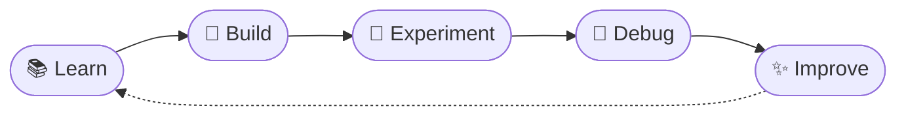

<!--
  FAHMIDUR ARNOB | GITHUB PROFILE
  Stylish Edition
-->

<div align="center">


<a href="https://github.com/fahmidur-rahman-arnob">
  
</a>

<br/><br/>

<a href="https://github.com/fahmidur-rahman-arnob"></a>
<a href="https://www.linkedin.com/in/md-fahmidur-rahman-arnob/"></a>


<br/><br/>


</div>

<br/>

---

## `01` &nbsp;/&nbsp; ⚡ About Me


```python
class Developer:
    def __init__(self):
        self.name     = "Fahmidur Arnob"
        self.role     = "Software Engineering Student"
        self.focus    = ["Python", "Backend Development", "REST APIs"]
        self.learning = ["FastAPI", "TypeScript", "MERN Stack", "SQL & MongoDB"]
        self.goal     = "Backend / Software Engineering opportunities"

    def philosophy(self):
        return "Learn → Build → Experiment → Debug → Improve"
```

I'm passionate about **backend engineering** and building practical, project-driven applications. I enjoy APIs, automation and understanding how software works behind the scenes.

<br clear="right"/>

---

## `02` &nbsp;/&nbsp; 🛠️ Tech Stack

<div align="center">

| Category | Technologies |
|:---:|:---|
| **Languages** |      |
| **Backend** |    |
| **Frontend** |  |
| **Databases** |   |
| **Tools** |     |

</div>

---

## `03` &nbsp;/&nbsp; 🎯 Current Focus

<div align="center">

| | Area | What I'm Working On |
|:---:|:---|:---|
| 🐍 | **Python** | Problem solving & application development |
| ⚡ | **Backend** | FastAPI, REST APIs & backend architecture |
| 🌐 | **MERN** | MongoDB, Express.js, React & Node.js |
| 🔷 | **TypeScript** | Type-safe JavaScript development |
| 🗄️ | **Database** | MongoDB & SQL concepts |

</div>

---

## `04` &nbsp;/&nbsp; 🚀 Featured Projects

<table>
<tr>
<td width="33%" valign="top">

### 📥 TermTorrent
*Terminal-Based Download Manager*

A qBittorrent-inspired terminal app focused on task management and persistent storage.

- CLI task management
- Status tracking
- Persistent storage
- Structured architecture


**[→ Repository](https://github.com/fahmidur-rahman-arnob/TermTorrent)**

</td>
<td width="33%" valign="top">

### 🔄 CodeSync
*API Integration & Backend*

A learning project on API communication, HTTP requests, JSON processing and modular logic.

- External API integration
- HTTP response handling
- JSON data processing
- Modular Python functions


**[→ GitHub](https://github.com/fahmidur-rahman-arnob)**

</td>
<td width="33%" valign="top">

### ☁️ DriveDrop
*Google Drive Upload Automation*

A terminal app that uploads local files straight to Google Drive via the Drive API.

- Drive API integration
- OAuth 2.0 authentication
- Local file processing
- Original format preserved


**[→ Repository](https://github.com/fahmidur-rahman-arnob/DriveDrop)**

</td>
</tr>
</table>

---

## `05` &nbsp;/&nbsp; 🏆 Certification

<div align="center">


**Complete Web Development Course: Certificate of Completion with Excellence**


<sub>JavaScript • HTML • CSS • React • Web Development Fundamentals</sub>

</div>

---

## `06` &nbsp;/&nbsp; 📊 GitHub Analytics

<div align="center">


</div>

---

## `07` &nbsp;/&nbsp; 🧭 My Learning Loop



<div align="center">

*Every project is a chance to understand something deeper and become a better developer.*

</div>

---

## `08` &nbsp;/&nbsp; 🤝 Let's Connect

<div align="center">

<a href="https://github.com/fahmidur-rahman-arnob"></a>
<a href="https://www.linkedin.com/in/md-fahmidur-rahman-arnob/"></a>

<br/><br/>

**Open to learning, collaboration, and new opportunities.**


</div>
